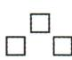
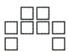
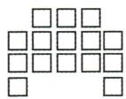
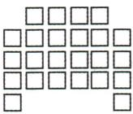

<!-- question-source:start -->
8[2024 重庆万州区期末]下列图形都是由相同的小正方形按照一定规律摆放而成的,第1个图形中小正方形的个数是3,第2个图形中小正方形的个数是8,第3个图形中小正方形的个数是15,…,照此规律排列下去,则第6个图形中小正方形的个数是()

A. 24

B. 30

C. 35

D. 48
<!-- question-source:end -->
