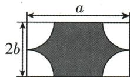

<!-- question-source:start -->
13[2024 山东青岛调研]如图是某居民小区的一块长为 $a$ 米、宽为 $2b$ 米的长方形空地.为了美化环境,准备在这个长方形空地的四个顶点处各修建一个半径为 $b$ 米的扇形花台,然后在花台内种花,其余地方种草.如果建造花台及种花的费用为每平方米 100 元,种草的费用为每平方米 50 元.

(1) 填空: 种花的面积为 \_\_\_\_ 平方米, 种草的面积为 \_\_\_\_ 平方米. (用含有 $a, b, \pi$ 的式子表示)

(2) 当 $a = 6, b = 2, \pi$ 取3.14时, 美化这块空地共需多少元?

<!-- question-source:end -->
