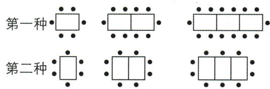

<!-- question-source:start -->
14[2024 河南周口期末]某餐厅中,一张桌子可坐6人,有以下两种摆放方式:

(1)有4张桌子,用第一种摆放方式,可坐多少人?用第二种摆放方式,可坐多少人?

(2)用含有 n 的代数式表示:有 n 张桌子,用第一种摆放方式可坐多少人?用第二种摆放方式可坐多少人?

(3)一天中午,餐厅要接待80位顾客共同就餐,但餐厅只有20张这样的桌子可用,且每4张拼成一张大桌子.若你是这家餐厅的经理,你打算选择哪种方式来摆放餐桌?并说明理由.

  
想刷题 想得睡不着
<!-- question-source:end -->
