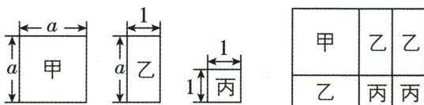

<!-- question-source:start -->
12[2024 河北石家庄期末]现有甲、丙两种正方形和乙种长方形卡片各若干张,如图(1)所示 $(a>1)$ . 小明分别用6张卡片拼出了如图(2)和图(3)的两个长方形(不重叠且无缝隙),其面积分别为 $S_{1},S_{2}$ .
(1)请用含 a 的式子分别表示 $S_{1}, S_{2}$ ;
(2) 当 a = 3 时, 通过计算比较 $S_{1}$ 与 $S_{2}$ 的大小.

图(1)

<table><tr><td>甲</td><td>乙</td><td>乙</td></tr><tr><td>乙</td><td>丙</td><td>丙</td></tr></table>

图(2)

<table><tr><td>乙</td><td>乙</td><td>乙</td><td>乙</td><td>乙</td><td>丙</td></tr></table>

图(3)
<!-- question-source:end -->

![[Q00098922A1]]
