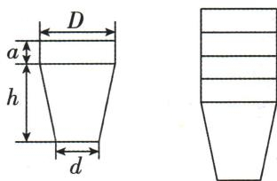

<!-- question-source:start -->
5[2024 四川雅安中考]如图是1个纸杯和若干个叠放在一起的纸杯的示意图,在探究纸杯叠放在一起后的总高度H与杯子数量n的变化规律的活动中,我们可以获得以下数据(字母),请选用适当的字母表示H= \_\_\_\_.

①杯子底部到杯沿底边的高 h; ②杯口直径 D;
③杯底直径 d; ④杯沿高 a.

<!-- question-source:end -->

![[Q00101243A1]]
