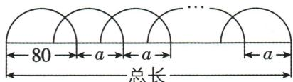

<!-- question-source:start -->
10[2024 河北承德期末]如图,某花园护栏用直径为 80 厘米的半圆形条钢组制而成,且每增加一个半圆形条钢,护栏长度就增加 a 厘米(相邻两个条钢之间都有交叉,a 为正整数).设半圆形条钢的总个数为 x(x 为正整数).

总长

(1) 当 a=50, x=2 时, 护栏总长度为 \_\_\_\_ 厘米;

(2) 当 a=60 时, 护栏总长度为 \_\_\_\_ 厘米 (用含 x 的代数式表示, 结果要求化简);

(3)若护栏的总长度为15米,为尽量减少条钢用量,a的值应为\_\_\_\_.
<!-- question-source:end -->

![[Q00101257A1]]
