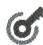

## 全章综合训练 刷中考

![[初中/课堂同步/教辅/必刷题/2026版《初中必刷题》数学 RJ  7上/03_第三章_代数式/全章综合训练/questions/Q00100476.md]]
![[初中/课堂同步/教辅/必刷题/2026版《初中必刷题》数学 RJ  7上/03_第三章_代数式/全章综合训练/questions/Q00100477.md]]
![[初中/课堂同步/教辅/必刷题/2026版《初中必刷题》数学 RJ  7上/03_第三章_代数式/全章综合训练/questions/Q00100478.md]]
![[初中/课堂同步/教辅/必刷题/2026版《初中必刷题》数学 RJ  7上/03_第三章_代数式/全章综合训练/questions/Q00100479.md]]

## 2刷素养▶ 走向重高

![[初中/课堂同步/教辅/必刷题/2026版《初中必刷题》数学 RJ  7上/03_第三章_代数式/全章综合训练/questions/Q00100480.md]]

## 难关

## 类型 1 递推型规律探索

![[初中/课堂同步/教辅/必刷题/2026版《初中必刷题》数学 RJ  7上/03_第三章_代数式/全章综合训练/questions/Q00100481.md]]
![[初中/课堂同步/教辅/必刷题/2026版《初中必刷题》数学 RJ  7上/03_第三章_代数式/全章综合训练/questions/Q00100482.md]]
![[初中/课堂同步/教辅/必刷题/2026版《初中必刷题》数学 RJ  7上/03_第三章_代数式/全章综合训练/questions/Q00100483.md]]

## 类型 2 累加型规律探索

![[初中/课堂同步/教辅/必刷题/2026版《初中必刷题》数学 RJ  7上/03_第三章_代数式/全章综合训练/questions/Q00100484.md]]
![[初中/课堂同步/教辅/必刷题/2026版《初中必刷题》数学 RJ  7上/03_第三章_代数式/全章综合训练/questions/Q00100485.md]]

# 课时1 同类项与合并同类项

电子错题本鸭

## 知识点 1 同类项的定义

![[初中/课堂同步/教辅/必刷题/2026版《初中必刷题》数学 RJ  7上/03_第三章_代数式/全章综合训练/questions/Q00100486.md]]
![[初中/课堂同步/教辅/必刷题/2026版《初中必刷题》数学 RJ  7上/03_第三章_代数式/全章综合训练/questions/Q00100487.md]]
![[初中/课堂同步/教辅/必刷题/2026版《初中必刷题》数学 RJ  7上/03_第三章_代数式/全章综合训练/questions/Q00100488.md]]

## 知识点 2 合并同类项

![[初中/课堂同步/教辅/必刷题/2026版《初中必刷题》数学 RJ  7上/03_第三章_代数式/全章综合训练/questions/Q00100489.md]]
![[初中/课堂同步/教辅/必刷题/2026版《初中必刷题》数学 RJ  7上/03_第三章_代数式/全章综合训练/questions/Q00100490.md]]
![[初中/课堂同步/教辅/必刷题/2026版《初中必刷题》数学 RJ  7上/03_第三章_代数式/全章综合训练/questions/Q00100491.md]]
![[初中/课堂同步/教辅/必刷题/2026版《初中必刷题》数学 RJ  7上/03_第三章_代数式/全章综合训练/questions/Q00100492.md]]
![[初中/课堂同步/教辅/必刷题/2026版《初中必刷题》数学 RJ  7上/03_第三章_代数式/全章综合训练/questions/Q00100493.md]]
![[初中/课堂同步/教辅/必刷题/2026版《初中必刷题》数学 RJ  7上/03_第三章_代数式/全章综合训练/questions/Q00100494.md]]
![[初中/课堂同步/教辅/必刷题/2026版《初中必刷题》数学 RJ  7上/03_第三章_代数式/全章综合训练/questions/Q00100495.md]]
