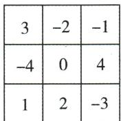
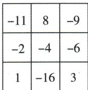

> [!success]- 必刷题
>
> > [!success] **【答案】** 3,3
>
> > [!note]- **【解析】**
> > 【解】(1)题图(1)中每一横行上的数的和都是15,所以9个数之和是15的3倍.15是9个格的“中心数”5的3倍.故答案为3,3.
> >
> > (2)如图(1).(答案不唯一)
> >
> > ## 关键点拨
> >
> > 利用有理数的加、减法法则，根据所给的条件推出 b, d 的可能取值是解题的关键.
> >
> > ## 关键点拨
> >
> > (2)根据每一横行、每一竖列以及两条对角线上的数的和都相等,且等于“中心数”的3倍求解.
> >
> >   
> > 图(1)
> >
> >   
> > 图(2)
> >
> > (3)如图(2).
> >
> > ## 综合与实践 进位制的认识与探究
> >
> > 
> >
> > ## 刷实践
> >
> > 【解】任务 1: (1) $243_{(7)} = 2 \times 7^{2} + 4 \times 7^{1} + 3 \times 7^{0} = 129$ .
> >
> > (2)2|22……0(第1位余数)
> > 2|11……1(第2位余数)
> > 2|5……1(第3位余数)
> > 2|2……0(第4位余数)
> > 1……1(第5位余数)
> >
> > 所以 $22=10110_{(2)}$ .
> >
> > (3) 存在. 根据题意: $aaa_{(6)} = a \times 6^{2} + a \times 6^{1} + a \times 6^{0} = 43a$ . 因为 43a 是一个十进制的两位数, 所以 a = 1 或 a = 2. 当 a = 1 时, 原数为 43, 新数为 34, 则 $43 - 34 = 9 \neq 18$ , 不是“青春数”, 不符合题意; 当 a = 2 时, 原数为 86, 新数为 68, 则 86 - 68 = 18, 是“青春数”, 符合题意. 所以这样的“青春数”存在, 这个“青春数”是 86.
> >
> > 任务 2: (1) $10110_{(2)} + 1101_{(2)} = 100011_{(2)}$ ，故答案为 $100011_{(2)}$ .
> >
> > (2) $110101_{(2)} - 11110_{(2)} = 10111_{(2)}$ ，故答案为 $10111_{(2)}$
> >
> > ## 全章综合训练
> >
> > 
