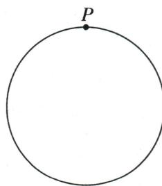

<!-- question-source:start -->
6 思想方法 数形结合 [2024 江苏盐城校级期中, 较难] 如图, 有一个长为 240 米的圆形跑道, 小明和他的小狗同时从跑道的点 $P$ 处出发沿顺时针方向跑步, 已知小明的速度为 4 米/秒, 小狗的速度为 12 米/秒, 跑步的时间记为 $t$ 秒, 在跑步过程中, 小明和他的小狗之间相距 (取两者之间较短一段圆弧跑道的长度) $w$ 米.

(1) 当 $0 < t \leqslant 60$ 时, 请用含 t 的代数式表示 w;
(2) 当 $600 < t \leqslant 630$ 时, 请用含 t 的代数式表示 w.

<!-- question-source:end -->

![[Q00095496A1]]
