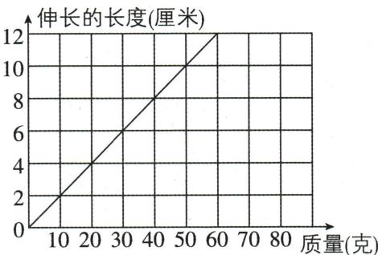

<!-- question-source:start -->
3[2024 天津南开区期末]有一种弹簧秤,秤上挂上物品(质量在 100 克以内)时,物品的质量与弹簧伸长的长度情况如图所示:

(1)如果挂质量为40克的物品,弹簧伸长的长度是\_\_\_\_厘米;当弹簧伸长的长度是4厘米时,所挂物品的质量是\_\_\_\_克.

(2) 弹簧伸长的长度与所挂物品的质量成 \_\_\_\_ 比例关系.
<!-- question-source:end -->

![[Q00095499A1]]
