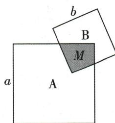

<!-- question-source:start -->
8[2024 山东滨州滨城区期中]学校劳动实践基地的开发能让学生体验劳动的艰辛,品味劳动成果的喜悦,满足学生劳动教育实践需要.某校劳动实践基地有两块边长分别为 a,b 的正方形土地 A,B,如图,其中不能使用的面积为 M.求正方形土地 B 中能使用的面积(用含 b,M 的代数式表示).

  
扶鸭起来
鸭还能学
<!-- question-source:end -->
