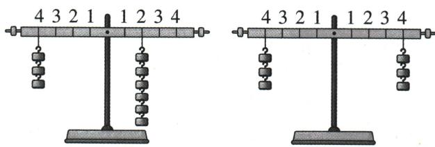

<!-- question-source:start -->
3[2025 河南驻马店期中, 中]同学们在探究“杠杆原理”时, 通过实验发现: 当左边刻度 4 上放 3 个砝码, 右边刻度及放砝码数如图所示, 这两种情况下两边平衡. 那么在右边其余刻度上放几个砝码才能保证平衡?

(1)请你完成表格.

<table><tr><td>右边刻度数</td><td>1</td><td>2</td><td>3</td><td>4</td></tr><tr><td>砝码数</td><td>___</td><td>6</td><td>___</td><td>3</td></tr><tr><td>乘积</td><td>___</td><td>___</td><td>___</td><td>___</td></tr></table>

(2)在本次实验中,右边刻度数和砝码数成什么比例关系?为什么?

<!-- question-source:end -->

![[Q00097010A1]]
