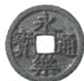

<!-- question-source:start -->
7[2025 河南驻马店期末]如图,圆形方孔钱是我国古钱币的突出代表,一枚圆形方孔钱的外半径为 r,中间方孔边长为 a,则圆形方孔钱的面积可表示为 ( )

A. $\pi r^2 -a^2$ B. $\pi r^2 +a^2$ C. $2\pi r - a^2$ D. $2\pi r + a^2$
<!-- question-source:end -->

![[Q00098861A1]]
