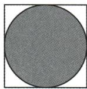
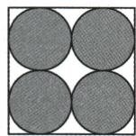
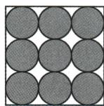

<!-- question-source:start -->
2[2025 山西大同质检, 中]如图, 正方形的边长均是 a, 以正方形①②③的顺序呈现的规律类推, 第⑨个正方形中所有圆的周长的和是（）

①

②

③

A. $\pi a$ B. $n\pi a$ C. $2a - \pi a$ D. $2a - n\pi a$
<!-- question-source:end -->

![[Q00101201A1]]
