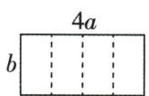
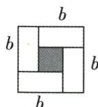

<!-- question-source:start -->
4[中]如图(1),一个长为4a、宽为b的长方形,沿虚线剪成四个大小完全相同的小长方形,则每个小长方形的宽为\_\_\_\_;然后用这四个小长方形拼成一个大正方形,如图(2),则图中阴影部分的面积为\_\_\_\_.

图(1)

图(2)
<!-- question-source:end -->

![[Q00101203A1]]
