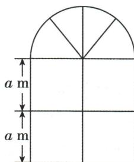

<!-- question-source:start -->
6 教材拓展 [2024 辽宁沈阳期末] 如图是一幢公寓窗户的形状, 其上部是半圆形, 下部是边长相同的四个小正方形, 已知下部的小正方形的边长为 $a \mathrm{~m}$ . (1) 窗户的总面积是多少? (窗框面积忽略不计) (2) 窗框的总长是多少? (3) 如果窗户上安装的是玻璃, 购买玻璃的费用是 40 元/ $\mathrm{m}^{2}$ , 购买窗框的费用是 24 元/ $\mathrm{m}$ , 当 $a = 0.5$ 时, 制作一扇窗户需要的费用是多少元? ( $\pi$ 取 3).

<!-- source-part:2 pages:51-100 -->
<!-- question-source:end -->

![[Q00095525A1]]
