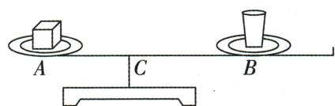

<!-- question-source:start -->
1[2025 辽宁大连期末, 中]数学活动课上, 王老师和同学们一起做了一个试验. 如图, 在仪器左边托盘 A(固定) 中放置一个物体, 在右边托盘 B(可左右移动) 中放置一个可以装水的容器, 容器的质量为 6 g. 在容器中加入一定质量的水, 可以使仪器左右平衡. 改变托盘 B 与点 C 的距离 $x (0 < x \leqslant 60$ , 单位: cm), 记录容器中加入的水的质量, 得到下表:

<table><tr><td>托盘B与点C的距离x/cm</td><td>...</td><td>50</td><td>40</td><td>30</td><td>20</td><td>10</td><td>...</td></tr><tr><td>容器与水的总质量 $y_1/g$ </td><td>...</td><td>12</td><td>15</td><td>20</td><td>30</td><td>60</td><td>...</td></tr><tr><td>加入的水的质量 $y_2/g$ </td><td>...</td><td>6</td><td>9</td><td>14</td><td>24</td><td>54</td><td>...</td></tr></table>

(1) $y_{1}$ 与x成\_\_\_\_关系,用式子表示 $y_{1}$ 与x的关系为\_\_\_\_;

(2)用式子表示 $y_{2}$ 与x的关系为\_\_\_\_；

(3) 当托盘 B 与点 C 的距离 x=6 cm 时, 求在容器中加入的水的质量 $y_{2}$ 的值.
<!-- question-source:end -->

![[Q00097020A1]]
