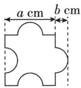
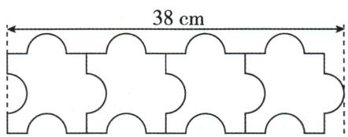

<!-- question-source:start -->
1[2025 河南安阳期末]有若干片相同的拼图,其形状如图(1)所示((a+b)cm为1片拼图的长度),凸出的部分是直径为4cm的半圆,且拼图沿水平方向排列时可紧密拼成一行,此时底部可与直线贴齐.当4片拼图紧密拼成一行时的长度为38cm,如图(2)所示.下列结论正确的是()

图(1)

图(2)
A. $4(a + b) = 38$ B.1片拼图的长度为 $9.5\mathrm{cm}$ C.将拼图紧密拼成一行时，每增加一片拼图，总长度增加 $11~\mathrm{cm}$ D.将 $n$ 片拼图紧密拼成一行时，总长度为 $(9n+$ $2)\mathrm{cm}$
<!-- question-source:end -->

![[Q00097023A1]]
