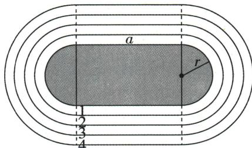

<!-- question-source:start -->
3[2024 福建泉州期中,较难]如图是某校田径运动场的平面图,最中间是长方形,长为 a 米,两端为半圆,最内侧半圆的半径为 r 米,每条跑道的宽为 1.2 米,共四个跑道.若每个跑道按内侧边线的总长度计算路程,请解答下列问题:

(1)第2跑道的总长度为\_\_\_\_米(结果用含a,r的代数式表示).

(2)第3跑道的总长度为\_\_\_\_米(结果用含a,r的代数式表示).

(3) 若 $a = 50$ , 且要求第 1 跑道的总长度为 200 米, ①求 $r$ 的值 (结果精确到个位, $\pi$ 取 3.1).

②在①的条件下,操场中心及两端的半圆(阴影部分)铺设人工草,跑道铺设塑胶,若铺人工草的价格为50元/平方米,铺塑胶的价格为100元/平方米,则学校共需付多少铺设费用(结果精确到个位, $\pi$ 取3.1)?

<!-- question-source:end -->

![[Q00098896A1]]
