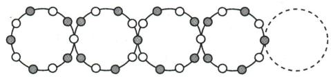

<!-- question-source:start -->
3[2025 安徽合肥期末]如图,用 5 个实心圆圈,5 个空心圆圈相间组成一个圆环,然后把这样的圆环从左到右按图中的规律组成圆环串,相邻两圆环有一公共圆圈,公共圆圈从左到右以空心圆圈和实心圆圈相间排列.

<table><tr><td>圆环串中圆环的个数(个)</td><td>1</td><td>2</td><td>3</td><td>4</td><td>5</td><td>6</td></tr><tr><td>实心圆圈和空心圆圈的总个数(个)</td><td>10</td><td>19</td><td>28</td><td></td><td></td><td></td></tr></table>
<!-- question-source:end -->

![[Q00099348A1]]
