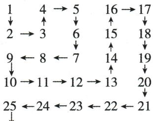

<!-- question-source:start -->
5[2025 辽宁朝阳期中]小亮和小明经常玩一种密码游戏:他们事先约定英文字母表中各字母位置的变化规则,以此实现加密和解密.有一次小亮给小明留了一张纸条,纸条上写着“kccr zcfglb rfc jgzpypw”,小明将其解密为“meet behind the library”.

(1) 小亮他们这次事先约定的字母位置变化规则是什么?

(2)你能用代数式表达他们的规则吗?

是个新“烤”鸭
<!-- question-source:end -->

![[Q00100445A1]]
