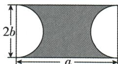

<!-- question-source:start -->
3[2024 吉林长春期中]如图,在一块长为 a, 宽为 2b 的长方形铁皮中, 以 2b 为直径在长方形铁皮的两边分别剪掉两个半圆, 若 a = 4, b = 1, 则剩下的铁皮的面积为( $\pi$ 取 3) ()

A. 5 B. 7 C. 8 D. 12
<!-- question-source:end -->

![[Q00101227A1]]
