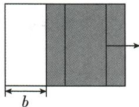
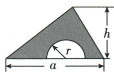

<!-- question-source:start -->
4 如图,一个长方形推拉窗,窗高 1.4 m,当活动窗扇沿图中所示的方向移动时,随着窗扇拉开长度 $b(\mathrm{~m})$ 的变化,窗户的通风面积 $A(\mathrm{~m}^{2})$ 也发生了变化.在这个变化过程中,当拉开长度 b从 0.1 m 变化到 0.4 m 时, 通风面积 A 从 \_\_\_\_ m² 变化到 \_\_\_\_ m². 下列选项正确的是 ( )
A. 0.14 5.6 B. 0.24 0.48
C. 0.14 0.56 D. 2.4 5.6

(第4题图)
(第5题图)
<!-- question-source:end -->

![[Q00101228A1]]
