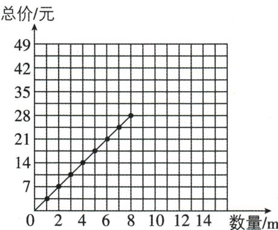

<!-- question-source:start -->
4[2024 四川成都质检, 中]文具店有一种彩带, 销售的数量与总价的关系如下表.

<table><tr><td>数量/m</td><td>1</td><td>2</td><td>3</td><td>4</td><td>5</td><td>6</td><td>7</td><td>8</td><td>...</td></tr><tr><td>总价/元</td><td>3.5</td><td>7</td><td>10.5</td><td>14</td><td>17.5</td><td>21</td><td>24.5</td><td>28</td><td>...</td></tr></table>

表中的数据还可以用下图表示.

根据图象回答下面的问题.

(1) 把数对 $(10,35)$ 和 $(12,42)$ 所在的点描出来，并和上面的图象连起来再延长，你能发现什么？

(2) 不计算, 根据图象判断, 如果买 9 m 彩带, 总价是多少? 49 元能买多少米彩带?

(3) 小明买的彩带的米数是小丽的 2 倍, 他花的钱是小丽的几倍? 你能举出生活中成正比例关系的例子吗?

你题还怪好的嘞

<table><tr><td>x</td><td>0</td><td>1</td><td>2</td><td>3</td></tr><tr><td>代数式的值</td><td>-3</td><td>-1</td><td>1</td><td>3</td></tr></table>
<!-- question-source:end -->

![[Q00097011A1]]
