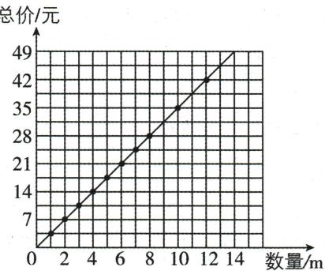

> [!success]- 必刷题
>
> > [!success] **【答案】** 详见解析
>
> > [!note]- **【解析】**
> > 【解】(1)如图所示:
> >
> > 根据成反比例关系的两个量的乘积一定进行判断即可.
> >
> > 根据甲和乙是两个成反比例关系的量正确列式即可.
> >
> > 
> >
> > 发现:从图中可以发现(10,35)和(12,42)对应的点也在这条直线上.
> >
> > (2) 观察上图, 可知图象经过数对 (9,31.5) 和 (14,49) 所在的点, 所以买 9 m 彩带, 总价是 31.5 元, 49 元能买 14 m 彩带.
> >
> > (3)他花的钱是小丽的2倍.
> >
> > 如:工作效率一定,工作总量和工作时间成正比例关系(答案不唯一).
