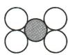
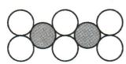
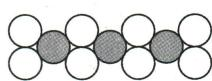
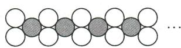

<!-- question-source:start -->
11[2023 山西中考]如图是一组有规律的图案,它由若干个大小相同的圆片组成.第1个图案中有4个白色圆片,第2个图案中有6个白色圆片,第3个图案中有8个白色圆片,第4个图案中有10个白色圆片,…,依此规律,第n个图案中有\_\_\_\_个白色圆片(用含n的代数式表示).

第1个

第2个

第3个

第4个
<!-- question-source:end -->

![[Q00101642A1]]
