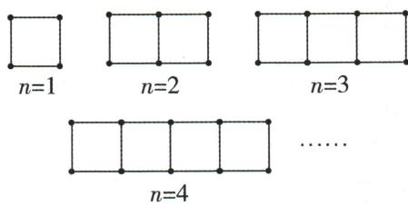

<!-- question-source:start -->
7[2024江西景德镇质检]如图所示,在下面由火柴棒拼出的一系列的图形中,第n个图形由n个正方形组成.

(1)第2个图形中,火柴棒的根数是\_\_\_\_;

(2)第3个图形中,火柴棒的根数是\_\_\_\_;

(3)第5个图形中,火柴棒的根数是\_\_\_\_;

(4)第 n 个图形中,火柴棒的根数是\_\_\_\_.
<!-- question-source:end -->

![[Q00101649A1]]
