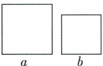
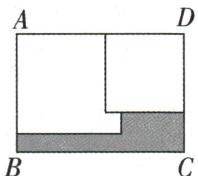
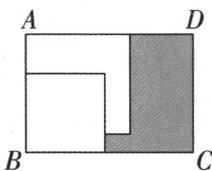

<!-- question-source:start -->
2[2024 北京朝阳区期末]将两边长分别为 a 和 b (a > b) 的正方形纸片（如图(1)）按图(2)、图(3)两种方式置于长方形 ABCD 中，（图(2)、图(3)中两张正方形纸片均有部分重叠），长方形中未被这两张正方形纸片覆盖的部分用阴影表示，设图(2)中阴影部分的周长为 $C_{1}$ ，图(3)中阴影部分的周长为 $C_{2}$ ，则 $C_{1} - C_{2}$ 的值为（）

图(1)

图(2)

图(3)

A. 0 B. $a - b$ C. $2a - 2b$ D. $2b - 2a$
<!-- question-source:end -->

![[Q00099015A1]]
