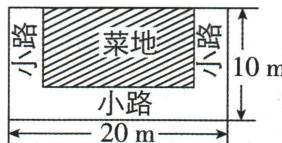

<!-- question-source:start -->
10 如图所示, 池塘边有块长为 20 m, 宽为 10 m 的长方形土地, 现在在三个方向留出宽都是 x m 的小路, 余下的长方形部分作菜地(图中的线段长短关系成立).

(1)菜地的长 $a =$ \_\_\_\_ m, 菜地的宽 $b =$ \_\_\_\_ m, 菜地的周长 $C =$ \_\_\_\_ m; (用含 $x$ 的式子表示)

(2) 当 x=1 时, 求菜地的周长 C.

<!-- question-source:end -->

![[Q00101302A1]]
