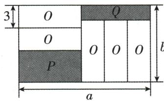

<!-- question-source:start -->
6[中]如图,长为a,宽为b的长方形被分割成7部分,除阴影图形P,Q外,其余5部分为形状和大小完全相同的小长方形O,其中小长方形O的宽为3.

(1) 求小长方形 O 的长 (用含 a 的代数式表示).

(2) 小明发现阴影图形 P 与阴影图形 Q 的周长之和与 a 值无关, 他的判断是否正确? 请说明理由.

<!-- question-source:end -->

![[Q00100524A1]]
