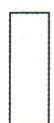
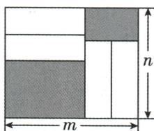

<!-- question-source:start -->
4[2024广西贵港质检]把四张形状大小完全相同的小长方形卡片(如图(1))不重叠地放在一个底面为长方形(长为m,宽为n)的盒子底部(如图(2)),盒子底面未被卡片覆盖的部分用阴影表示,则图(2)中两块阴影部分的周长和是()

图(1)

图(2)

A. $4n$ B. $4m$ C. $2(m + n)$ D. $4(m - n)$
<!-- question-source:end -->

![[Q00101622A1]]
