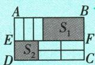

> [!success]- 必刷题
>
> > [!success] **【答案】** A
>
> > [!note]- **【解析】**
> > 设小长方形卡片的长为 a，宽为 b，则 $C_{\text{上面的阴影}} = 2(n - a + 2b)$ ， $C_{\text{下面的阴影}} = 2(a + n -$
> >
> > 
> >
> > 2b)，所以两块阴影部分的周长和为 $C_{\text{上面的阴影}} + C_{\text{下面的阴影}} = 2(n - a + 2b) + 2(a + n - 2b) = 2n - 2a + 4b + 2a + 2n - 4b = 4n.$
> >
> > 故选 **A**.
