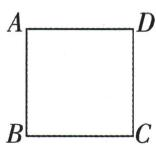
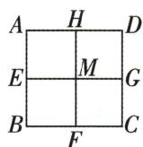
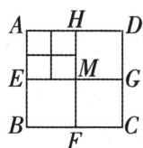

<!-- question-source:start -->
5[较难]将正方形ABCD(如图(1))作如下划分:第1次划分:分别连接正方形ABCD对边的中点(如图(2)),得线段HF和EG,它们交于点M,此时图(2)中共有5个正方形;第2次划分:将图(2)左上角正方形AEMH再划分,得图(3),则图(3)中共有9个正方形.

(1)若把左上角的正方形依次划分下去,则第100次划分后,图中共有\_\_\_\_个正方形.

(2) 继续划分下去, 第 n 次划分后图中共有 \_\_\_\_ 个正方形.

(3)能否将正方形 ABCD 划分成有 2020 个正方形的图形？如果能，请算出是第几次划分；如果不能，需说明理由.

图(1)
图(2)

图(3)
<!-- question-source:end -->

![[Q00097081A1]]
