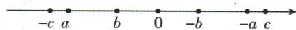

> [!success]- 必刷题
>
> > [!success] **【答案】** 详见解析
>
> > [!note]- **【解析】**
> > 【解】(1)在数轴上标出-a,-b,-c这三个数所对应的点,如下图.将a,b,c,-a,-b,-c这6个数按从小到大的顺序用“<”连接如下:-c<a<b<-b<-a<c.
> >
> > 
> >
> > (2)由题意得 $a < b < 0 < c$ ，所以 $-a > 0, -b > 0, -c < 0$ ，所以 $-a - b > 0, b - c < 0, c - a > 0$ ，所以 $|-a - b| + |b - c| - |c - a| = -a - b + (c - b) - (c - a) = -a - b + c - b - c + a = -2b.$
> >
> > (3) 因为表示数 $a$ 的点向左运动 1 个单位长度后在数轴上对应的数恰好与 c 互为相反数，
> > 所以 a-1+c=0，所以 $a+c=1$ 。因为 $a+b+c=0$ ，
> > 所以 b=-1. -3(a-b)-(c+5)-2(c+4b)=-3a+3b-c-5-2c-8b=-3a-5b-3c-5=-3(a+c)-5b-5=-3×1-5×(-1)-5=-3+5-5=-3。
> >
> > 
> >
> > 
