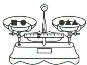
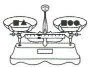

<!-- question-source:start -->
1[2024 贵州中考]小红学习了等式的性质后,在甲、乙两台天平的左右两边分别放入“■”“●”“▲”三种物体,如图所示,天平都保持平衡.若设“■”与“●”的质量分别为x,y,则下列关系式正确的是()

甲

乙

A. $x = y$ B. $x = 2y$ C. $x = 4y$ D. $x = 5y$
<!-- question-source:end -->

![[Q00097684A1]]
