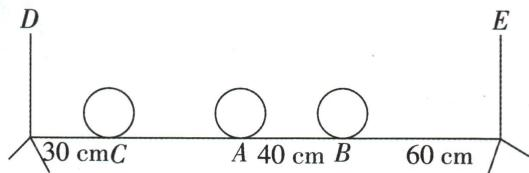
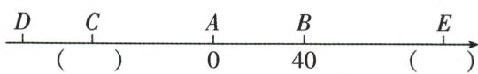

<!-- question-source:start -->
14 在一个“磁悬浮”的轨道架上做钢球碰撞实验,如图(1)所示,轨道长为 $180 \, cm$ , 轨道架上有三个大小、质量完全相同的钢球 A, B, C, 轨道左右各有一个钢制挡板 D 和 E, 其中 C 到左挡板的距离为 $30 \, cm$ , B 到右挡板的距离为 $60 \, cm, A, B$ 两球相距 $40 \, cm$ . 现以轨道所在直线为数轴, 假定 A 球在原点, B 球表示的数为 40, 如图(2)所示, 解答下列问题:

图(1)

图(2)

(1) 在数轴上, 找出 C 球及右挡板 E 所表示的数, 并填在图(2)中的括号内.

(2) 碰撞实验中(钢球大小、相撞时间不记), 钢球的运动都是匀速, 当一钢球以一速度撞向另一静止钢球时, 这个钢球停留在被撞钢球的位置, 被撞钢球则以同样的速度向前运动, 钢球撞到左右挡板则以相同的速度反向运动.

①现 A 球以每秒 10 cm 的速度向右匀速运动, 则 A 球第二次到达 B 球所在位置时用了 \_\_\_\_ s; 经过 63 s 时, A, B, C 三球在数轴上所对应的数分别是 \_\_\_\_, \_\_\_\_, \_\_\_\_.

②如果 A, B 两球同时开始运动, A 球向左运动, B 球向右运动, A 球的速度是 8 cm/s, B 球的速度是 12 cm/s, 问: 经过多长时间 A, B 两球第一次相撞? 第一次相撞时在数轴上所对应的数是多少?
<!-- question-source:end -->

![[Q00101791A1]]
