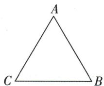

<!-- question-source:start -->
2[2025 河南郑州质检]如图,等边三角形跑道的三个端点 A,B,C 上分别站着甲、乙、丙三人,其中甲的速度是丙的 5 倍. 若三人同时顺时针出发,20 分钟后甲首次追上丙,同时乙也首次追上了丙. 若三人同时逆时针出发,甲首次追上丙和首次追上乙之间相差 ( )

A.20分钟 B.30分钟C.35分钟 D.40分钟
<!-- question-source:end -->

![[Q00100639A1]]
