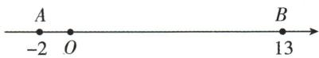

<!-- question-source:start -->
2[2024 河南洛阳期末, 中]数轴体现了数形结合的数学思想, 若数轴上点 A, B 表示的数分别为 a, b, 则 A, B 两点之间的距离表示为 $AB = |a - b|$ . 如: 点 A 表示的数为 2, 点 B 表示的数为 3, 则 $AB = |2 - 3| = 1$ .

(1) 问题提出: 填空: 如图, 数轴上点 A 表示的数为 -2, 点 B 表示的数为 13, A, B 两点之间的距离 AB=\_\_\_\_，线段 AB 的中点表示的数为\_\_\_\_。

(2) 拓展探究: 在 (1) 的条件下, 若点 P 从点 A 出发, 以每秒 3 个单位长度的速度沿数轴向右运动, 同时点 Q 从点 B 出发, 以每秒 2 个单位长度的速度向左运动. 设运动时间为 t 秒 (t > 0).

①用含 t 的式子表示: t 秒后, 点 P 表示的数为 \_\_\_\_, 点 Q 表示的数为 \_\_\_\_;

②求当 t 为何值时, P, Q 两点相遇, 并写出相遇点所表示的数.

(3) 类比延伸: 在(2)的条件下, 如果 P, Q 两点相遇后按照原来的速度继续运动, 当各自到达线段 AB 的端点后立即改变运动方向, 并以原来的速度在线段 AB 上做往复运动, 那么再经过多长时间 P, Q 两点第二次相遇? 请求出此时相遇点所表示的数.
<!-- question-source:end -->

![[Q00097678A1]]
