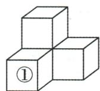

<!-- question-source:start -->
2[2024 山东济南期中]如图,将小立方块①从 4 个大小相同的小立方块所搭的几何体中移走后,所得几何体 ( )

A.从上面看到的图形改变,从左面看到的图形改变
B.从上面看到的图形不变,从左面看到的图形改变

C. 从前面看到的图形改变,从左面看到的图形不变
D. 从前面看到的图形不变,从左面看到的图形不变
<!-- question-source:end -->

![[Q00100691A1]]
