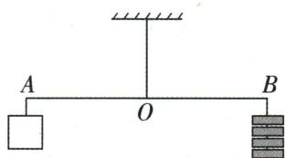

<!-- question-source:start -->
4[2025 辽宁沈阳质检]在数学活动课上,兴趣小组的同学用一根质地均匀的轻质木杆和若干个钩码做实验.如图,在轻质木杆中点 O 处用一根细线悬挂,左端 A 处挂一重物,右端 B 处挂钩码,每个钩码质量是 m 克.若挂 4 个钩码可使轻质木杆左右平衡.设重物的质量为 x 克,把 m 作为已知数,则()

A. $4x = m$ B. $4 + x = m$ C. $x = 4m$ D. $x = 4 + m$

是个新“烤”鸭
<!-- question-source:end -->

![[Q00101771A1]]
