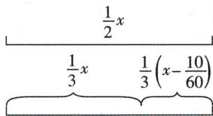

> [!success]- 必刷题
>
> > [!success] **【答案】** 详见解析
>
> > [!note]- **【解析】**
> > 【解】设两管同时开了 x 小时. 由题意, 得 $\left(\frac{1}{2}-\frac{1}{3}\right)x=\frac{1}{3}\left(x-\frac{10}{60}\right)$ , 解得 $x=\frac{1}{3}$ . 所以两管同时开了 $\frac{1}{3}$ 小时.
> >
> > 一题多解 设两管同时开了 x 小时. 画出线段图如图所示:
> >
> > 进水管进水量: $\frac{1}{2}x$ 出水管出水量:
> >
> > 
> >
> > 由题意, 得 $\frac{1}{2}x = \frac{1}{3}x + \frac{1}{3}\left(x - \frac{10}{60}\right)$ ，解得 $x = \frac{1}{3}$ .
> > 所以两管同时开了 $\frac{1}{3}$ 小时.
> >
> > ## 刷素养·
