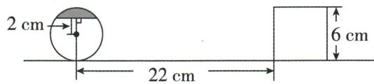

<!-- question-source:start -->
3[2024 浙江宁波质检]如图,一个直径为 6 cm 的圆中阴影部分面积为 S,现在这个圆与正方形在同一平面内,沿同一条直线同时相向无滚动滑动. 圆每秒滑动 3 cm,正方形每秒滑动 2 cm,第\_\_\_\_秒时,圆与正方形重叠部分面积是 S.

<!-- question-source:end -->

![[Q00097661A1]]
