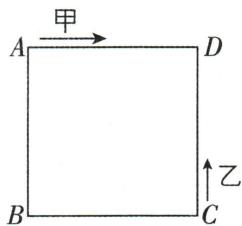

<!-- question-source:start -->
3[2024 安徽蚌埠期末, 中]如图, 甲、乙两动点分别从正方形 ABCD 的顶点 A, C 同时沿正方形的边开始匀速运动, 甲按顺时针方向运动, 乙按逆时针方向运动, 若乙的速度是甲的 3 倍, 那么它们第一次相遇在 AD 边上, 则它们第 2023 次相遇在 \_\_\_\_ 边上.

<!-- question-source:end -->

![[Q00097666A1]]
