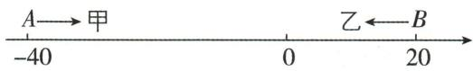

<!-- question-source:start -->
5 思想方法 数形结合 [2025 吉林长春期末, 中] 如图, 已知数轴上有 A, B 两点, 分别代表 -40, 20, 两只电子蚂蚁甲、乙分别从 A, B 两点同时出发, 甲沿线段 AB 以 1 个单位长度/秒的速度向右运动, 甲到达点 B 处时运动停止, 乙沿 BA 方向以 4 个单位长度/秒的速度向左运动.

(1) $A, B$ 两点间的距离为 \_\_\_\_ 个单位长度; 乙到达 $A$ 点时共运动了 \_\_\_\_ 秒.

(2)甲、乙在数轴上的哪个数对应的点相遇?

(3)多少秒时,甲、乙相距10个单位长度?

(4) 若乙到达 A 点后立刻掉头并保持速度不变向右运动, 则甲到达 B 点前, 甲、乙还能在数轴上相遇吗? 若能, 求出相遇点所对应的数; 若不能, 请说明理由.
<!-- question-source:end -->

![[Q00099127A1]]
