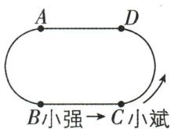

<!-- question-source:start -->
2[中]如图,跑道由两个半圆部分和两条直跑道AD,BC组成,两个半圆跑道的长都是122 m,两条直跑道的长都是85 m.小斌站在C处,小强站在B处,两人同时沿逆时针方向跑步,小斌每秒跑7 m,小强每秒跑12 m.当小强第一次追上小斌时,他们的位置在()

A.半圆跑道 $AB$ 上 B.直跑道 $BC$ 上C.半圆跑道 $CD$ 上 D.直跑道 $AD$ 上
<!-- question-source:end -->

![[Q00101753A1]]
