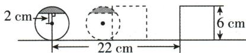
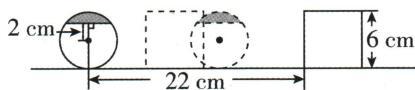

> [!success]- 必刷题
>
> > [!success] **【答案】** 4或6
>
> > [!note]- **【解析】**
> > 设第 t 秒时, 圆与正方形重叠部分面积为 S. 当圆与正方形刚接触重叠时, 如图(1), 根据题意, 得 $2t + 3t + 2 = 22$ , 解得 t = 4;
> >
> > 
> > 图(1)
> >
> > 当圆与正方形将要分开重叠时,如图(2),根据题意,得 $2t+3t-(6+2)=22$ , 解得 t=6.
> >
> > 
> > 图(2)
> >
> > 综上,第4或6秒时,圆与正方形重叠部分面积为S.故答案为4或6.
