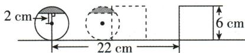
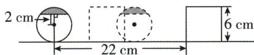

> [!success]- 必刷题
>
> > [!success] **【答案】** B
>
> > [!note]- **【解析】**
> > 设丙的速度为 v，则甲的速度为 5v。设乙的速度为 $v_{乙}$ ，等边三角形跑道的边长为 a。由题意可得 $20(5v-v)=2a, 20(v_{乙}-v)=a$ ，解得 a=40v， $v_{乙}=3v$ 。设甲追上乙需要 $t_{1}$ 分钟，由题意可得 $t_{1}\times(5v-3v)=2a=80v$ ，解得 $t_{1}=40$ 。设甲追上丙需要 $t_{2}$ 分钟，由题意可得 $t_{2}\times(5v-v)=a=40v$ ，解得 $t_{2}=10$ ，所以甲首次追上丙和首次追上乙之间相差 $t_{1}-t_{2}=40-10=30$ （分），故选 B。
> >
> > 3.4 或 6 【解析】设第 t 秒时, 圆与正方形重叠部分面积为 S. 当圆与正方形刚接触重叠时, 如图(1), 根据题意, 得 $2t + 3t + 2 = 22$ , 解得 t = 4;
> >
> > 
> > 图(1)
> >
> > 当圆与正方形将要分开重叠时,如图(2),根据题意,得 $2t+3t-(6+2)=22$ , 解得 t=6.
> >
> > 
> > 图(2)
> >
> > 综上,第4或6秒时,圆与正方形重叠部分面积为S.故答案为4或6.
