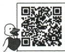

## 课时4 分段计费问题与方案问题 刷基础

![[初中/课堂同步/教辅/必刷题/2026版《初中必刷题》数学 RJ  7上/05_第五章_一元一次方程/课时4_分段计费问题与方案问题/questions/Q00100669.md]]
![[初中/课堂同步/教辅/必刷题/2026版《初中必刷题》数学 RJ  7上/05_第五章_一元一次方程/课时4_分段计费问题与方案问题/questions/Q00100670.md]]
![[初中/课堂同步/教辅/必刷题/2026版《初中必刷题》数学 RJ  7上/05_第五章_一元一次方程/课时4_分段计费问题与方案问题/questions/Q00100671.md]]
![[初中/课堂同步/教辅/必刷题/2026版《初中必刷题》数学 RJ  7上/05_第五章_一元一次方程/课时4_分段计费问题与方案问题/questions/Q00100672.md]]
![[初中/课堂同步/教辅/必刷题/2026版《初中必刷题》数学 RJ  7上/05_第五章_一元一次方程/课时4_分段计费问题与方案问题/questions/Q00100673.md]]
![[初中/课堂同步/教辅/必刷题/2026版《初中必刷题》数学 RJ  7上/05_第五章_一元一次方程/课时4_分段计费问题与方案问题/questions/Q00100674.md]]
![[初中/课堂同步/教辅/必刷题/2026版《初中必刷题》数学 RJ  7上/05_第五章_一元一次方程/课时4_分段计费问题与方案问题/questions/Q00100675.md]]
![[初中/课堂同步/教辅/必刷题/2026版《初中必刷题》数学 RJ  7上/05_第五章_一元一次方程/课时4_分段计费问题与方案问题/questions/Q00100676.md]]

## 二、填空题(每小题6分,共18分)

![[初中/课堂同步/教辅/必刷题/2026版《初中必刷题》数学 RJ  7上/05_第五章_一元一次方程/课时4_分段计费问题与方案问题/questions/Q00100677.md]]
![[初中/课堂同步/教辅/必刷题/2026版《初中必刷题》数学 RJ  7上/05_第五章_一元一次方程/课时4_分段计费问题与方案问题/questions/Q00100678.md]]
![[初中/课堂同步/教辅/必刷题/2026版《初中必刷题》数学 RJ  7上/05_第五章_一元一次方程/课时4_分段计费问题与方案问题/questions/Q00100679.md]]

## 三、解答题（共50分）

![[初中/课堂同步/教辅/必刷题/2026版《初中必刷题》数学 RJ  7上/05_第五章_一元一次方程/课时4_分段计费问题与方案问题/questions/Q00100680.md]]
![[初中/课堂同步/教辅/必刷题/2026版《初中必刷题》数学 RJ  7上/05_第五章_一元一次方程/课时4_分段计费问题与方案问题/questions/Q00100681.md]]
![[初中/课堂同步/教辅/必刷题/2026版《初中必刷题》数学 RJ  7上/05_第五章_一元一次方程/课时4_分段计费问题与方案问题/questions/Q00100682.md]]

## 6.1 几何图形

## 6.1.1 立体图形与平面图形

电子错题本鸭

课时 1 认识几何图形

## 知识点 1 生活中的几何图形

