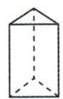
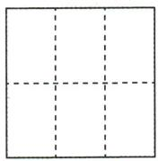
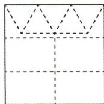

<!-- question-source:start -->
2[2024 河南周口期末, 中]用正方形硬纸板做三棱柱盒子(如图(1)), 每个盒子由 3 个长方形侧面和 2 个等边三角形底面组成, 硬纸板按如图(2)所示的方式裁剪(裁剪后边角料不再利用). A 方法: 剪 6 个侧面; B 方法: 剪 4 个侧面和 5 个底面. 现有 19 张硬纸板, 若 x 张硬纸板用 A 方法裁剪, 其余硬纸板用 B 方法裁剪, 则有以下说法: ①裁剪出的侧面的个数为 $(2x + 76)$ 个; ②裁剪出的底面的个数为 $(-5x + 95)$ 个; ③若裁剪出的侧面和底面恰好全部用完, 最多可以做的盒子个数为 30 个. 其中说法正确的有 \_\_\_\_个.

A方法
图(1)

图(2)
B方法
<!-- question-source:end -->

![[Q00100628A1]]
