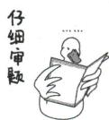

<!-- question-source:start -->
3 数学老师在黑板上写了如图所示的两个关于 x 的方程, 并解出方程①的解比方程②的解小 4, 则 a 的值为 ( )

$$
\begin{array}{l} \boxed {① \frac {x + a}{2} = \frac {x + a}{3};} \\ \boxed {② 6 a - 2 x = x + 6.} \end{array}
$$

A. $\frac{3}{2}$ B. $-\frac{3}{2}$ C. 2 D. -2
<!-- question-source:end -->

![[Q00101710A1]]
